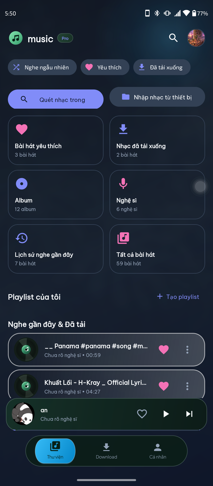
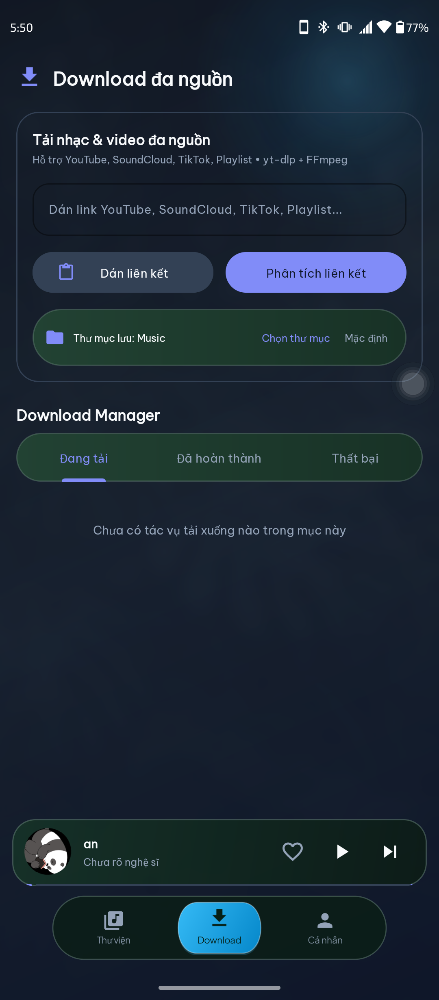
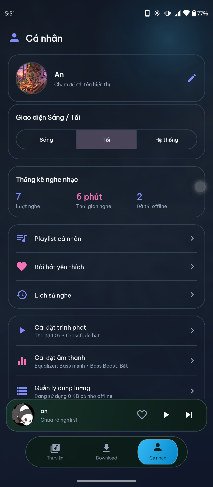

# Music

Ứng dụng nghe nhạc offline cho Android, phong cách Zing MP3, với trình phát nhạc đầy đủ, quản lý thư viện cá nhân và tải nhạc đa nguồn.

<div align="center">
  
  
  
</div>

## Giới thiệu

**Music** là ứng dụng nghe nhạc offline dành cho thiết bị Android, hỗ trợ phát nhạc từ bộ nhớ local, tải nhạc từ nhiều nguồn (YouTube, SoundCloud, TikTok, Playlist…), quản lý playlist, bài yêu thích và cá nhân hóa giao diện.

Ứng dụng được viết bằng **Java**, sử dụng kiến trúc **Repository + ViewModel + LiveData**, CSDB cục bộ bằng **Room**, và engine tải multimedia bằng **yt-dlp-android**.

## Tính năng

### Phát nhạc
- Phát nhạc offline từ bộ nhớ thiết bị bằng `MediaPlayer`
- Điều khiển phát/tạm dừng, bài trước/bài sau, lặp lại (none/one/all)
- Equalizer (BassBoost) và tốc độ phát (1.0×, crossfade)
- Mini player cố định dưới cùng màn hình (album art, tên bài, nút điều khiển)
- Foreground service với notification có nút điều khiển nhanh

### Thư viện & quản lý
- Danh sách tất cả bài hát, bài nghe gần đây, bài đã tải offline
- Bài yêu thích (favorite), playlist cá nhân
- Xem theo Album, Artist, Radio
- Quét nhạc trên thiết bị và import audio từ URI

### Tìm kiếm
- Tìm kiếm theo All / Songs / Artists / Albums / Playlists
- Lưu lịch sử tìm kiếm và gợi ý chip

### Tải nhạc đa nguồn
- Nhập link YouTube, SoundCloud, TikTok, Playlist…
- Phân tích nguồn qua `MultiSourceAnalyzer` (yt-dlp + FFmpeg + aria2c)
- Chọn định dạng (MP3/MP4) và chất lượng tải
- Download Manager: theo dõi Đang tải / Đã hoàn thành / Thất bại

### Cá nhân hóa & cài đặt
- Thông tin cá nhân và thống kê (lượt nghe, thời gian, dung lượng offline)
- 12 theme preset (6 sáng soft neumorphic, 6 tối soft dark), gradient glow tự động từ album art
- Hỗ trợ 8 ngôn ngữ: Tiếng Việt, English, Bahasa Indonesia, 日本語, 한국어, 中文 (简体), Français, Español + hệ thống

## Screenshots

| Màn hình chính | Tải nhạc | Cá nhân |
|---|---|---|
|  |  |  |

## Technology stack

| Thành phần | Công nghệ |
|---|---|
| Ngôn ngữ | Java 11 |
| Framework | Android SDK (minSdk 26, targetSdk 36) |
| Kiến trúc | Repository + ViewModel + LiveData (Manual DI) |
| CSDB cục bộ | Room 2.7.0 |
| Load ảnh | Glide 4.16.0 |
| Mạng | OkHttp 4.10.0 + logging interceptor |
| JSON | Gson 2.11.0 |
| Tải đa nguồn | yt-dlp-android 0.18.1 (library, ffmpeg, aria2c) |
| Phát thanh | Android MediaPlayer + BassBoost |
| UI | AndroidX AppCompat, Material Components, RecyclerView, ViewPager2, Fragment, Palette |
| Build | Gradle Kotlin DSL, AGP 9.1.1 |

## Kiến trúc tổng quan

```
com.music.annnnn
├── data/
│   ├── local/          # Room DB, DAO, LocalMusicScanner, PreferencesManager
│   ├── download/       # MediaEngineInitializer, MultiSourceAnalyzer, MediaStorageHelper
│   ├── network/        # YouTubeAnalyzer
│   └── repository/     # MusicRepository (single source of truth)
├── player/             # PlaybackController (MediaPlayer, BassBoost)
├── service/            # MusicPlaybackService, MediaDownloadService (foreground)
├── ui/
│   ├── main/           # MainActivity (container fragments)
│   ├── library/        # LibraryFragment
│   ├── profile/        # ProfileFragment
│   ├── search/         # SearchActivity
│   ├── detail/         # DetailActivity (album/playlist/artist/radio…)
│   ├── player/         # FullPlayerActivity
│   ├── download/       # DownloadFragment
│   ├── common/         # BaseMusicActivity, adapters, helpers
│   └── widget/         # LiquidBottomNavView
└── util/               # ThemeStudioManager, CoverLoader, DiscSpinAnimator, …
```

Dữ liệu chảy một chiều: Repository → ViewModel → LiveData → UI. Xử lý nền chạy trên `AppDatabase.DATABASE_EXECUTOR`.

## Cấu trúc project (root)

```
MusicPlayer/
├── README.md
├── CHANGELOG.md
├── LICENSE
├── CONTRIBUTING.md
├── .gitignore
├── build.gradle.kts
├── settings.gradle.kts
├── gradle.properties
├── app/                # Module ứng dụng (source, res, manifest)
├── gradle/             # Gradle wrapper + libs.versions.toml
├── Screenshot/         # Ảnh chụp màn hình dùng cho README
└── public/             # Assets nền tảng AI Studio
```

## Yêu cầu môi trường

- **Android Studio** (khuyên dùng Flamingo 이상 hoặc mới nhất)
- **JDK 11** (hoặc cao hơn, tương thích với AGP 9.1.1)
- **Android SDK** API 26 (Android 8.0) trở lên
- **compileSdk 36**, **targetSdk 36**
- Kết nối internet cho tính năng tải đa nguồn
- Quyền `READ_MEDIA_AUDIO`, `POST_NOTIFICATIONS`, `FOREGROUND_SERVICE`

## Hướng dẫn cài đặt & build

### 1. Clone repository
```bash
git clone https://github.com/<username>/MusicPlayer.git
cd MusicPlayer
```

### 2. Mở project trong Android Studio
- Chọn **File → Open** và chọn thư mục chứa project.
- Android Studio sẽ tự động đồng bộ Gradle. Chờ quá trình sync hoàn tất.

### 3. Cấu hình ký release (tùy chọn)
Project sử dụng `signingConfigs` trong `app/build.gradle.kts`. Các file keystore (`.jks`, `debug.keystore`, `release-key.jks`) đã được loại khỏi Git theo `.gitignore`.
- Nếu build release: đặt file keystore vào thư mục root và thiết lập biến môi trường `KEYSTORE_PATH`, `STORE_PASSWORD`, `KEY_PASSWORD`.
- Nếu không cấu hình, build sẽ sử dụng debug keystore mặc định.

### 4. Chạy ứng dụng
- Kết nối thiết bị Android hoặc khởi động emulator (API 26+).
- Chọn **Run → Run 'app'** hoặc bấm `Shift + F10`.

## Trạng thái phát triển

| Mốc | Trạng thái |
|---|---|
| Phát nhạc offline | ✅ Hoàn thành |
| Tải đa nguồn | ✅ Hoàn thành |
| Thư viện & playlist | ✅ Hoàn thành |
| Tìm kiếm | ✅ Hoàn thành |
| Profile & cài đặt | ✅ Hoàn thành |
| Theme & đa ngôn ngữ | ✅ Hoàn thành |
| Đăng nhập / Cloud sync | ❌ Chưa triển khai |
| Lyrics / Podcast | ❌ Chưa triển khai |
| Widget màn hình chính | ❌ Chưa triển khai |
| Casting (Chromecast) | ❌ Chưa triển khai |

## Giới hạn đã biết

- Ứng dụng chủ yếu hoạt động offline cho nhạc đã có sẵn trên thiết bị.
- Tải nhạc đa nguồn phụ thuộc vào kết nối internet và khả năng truy cập nguồn bên thứ ba (YouTube, SoundCloud, TikTok…).
- Các file keystore (`.jks`) không được lưu trong repository vì lý do bảo mật. Cần tự tạo hoặc cung cấp keystore riêng khi build release.
- Không có hàm sách cloud sync; dữ liệu thư viện và playlist chỉ lưu cục bộ trên thiết bị.

## License

Chưa chọn giấy phép. Vui lòng liên hệ tác giả hoặc chọn giấy phép thích hợp trước khi sử dụng/source.
